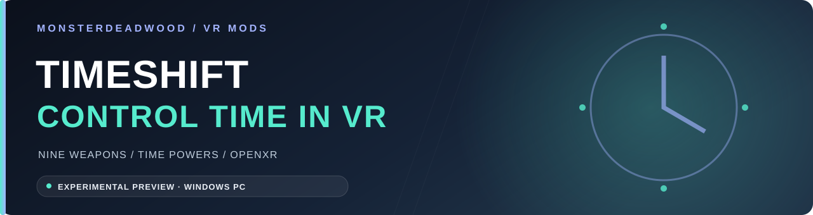

> [!IMPORTANT]
> **[TEST BUILDS & DISCUSSION · FLAT2VR DISCORD](https://discord.gg/P4q9zt7ek)**
> Testing, build requests, feedback and discussion happen in the **Flat2VR Modding Discord**. Join the server and find the **TimeShift VR** thread.

# TimeShift VR

[English](README.md) · [Русский](README_RU.md) · [Flat2VR Discord](https://discord.gg/P4q9zt7ek) · [All projects](PORTFOLIO.md)

TimeShift in VR with controller-directed weapons, time manipulation, two-handed support and a VR settings menu. Play seated, or enable Roomscale for headset-driven crouching through the game’s original posture system.

**Current documented branch: R65a community package / R66 precision candidate.**

## Installation

1. Get the current **TimeShift VR** test package in the TimeShift thread on Flat2VR, matched to its supported game executable.
2. Extract the complete **Put Me in Folder of Game** folder into the TimeShift directory, beside **bin**.
3. Connect PC VR, activate its OpenXR runtime and open **RUN.bat** inside the mod folder.
4. Seated mode is the default. Hold Left Menu, open Options → VR Settings to choose Roomscale, then tap Left Menu at a comfortable height.

Current test-package availability is coordinated in Discord. Use the complete package for your supported game build; this project page is separate from a release download.

## What this project brings to VR

- Stereo VR, tracked aiming and all nine weapons in the development/test branch.
- Slow, freeze and reverse time directly from controller inputs.
- Two-hand support at authored weapon grips, with a free hand after release.
- Saved VR settings, smooth/snap turning, seated and Roomscale posture modes.
- Physical crouch requests the original game posture/collision profile.
- Launcher progress feedback and local SEND_TO_DISCORD diagnostics.

<b>Controller quick reference</b>

| Input | Action |
| --- | --- |
| Left stick / click | Move / hold crouch |
| Right stick horizontal | Smooth or snap turn |
| Right stick up / down / click | Reverse / slow / freeze time; repeat a mode to cancel it |
| Right trigger / left trigger | Primary / secondary fire |
| Right grip / left grip | Reload / weapon support near grip, otherwise Use + laser |
| A / X | Jump and confirm / interact |
| B tap / hold | Next / previous weapon |
| Y tap / hold | Throw grenade / next grenade type |
| Left Menu tap / hold | Recenter / game menu; hold threshold 650 ms |

The complete package control sheet takes precedence for its version and interaction profile.

## Current status

**Experimental preview.** Native-game/XR Sim checks cover posture, recenter, selected video transitions and nine-weapon firing in the recorded revisions.

- Physical-headset comfort and full-campaign Roomscale coverage remain open; low ceilings, ladders and platforms need broader playtesting.
- Compatibility is tied to the package’s supported EXE identities; support for every Steam/retail executable is not established.

R66 tests tracked primary-fire precision while retaining the shotgun pellet cone. It is a distinct experimental candidate; precision_aim=false restores the original accuracy model.

[Detailed status and validation scope](docs/PROJECT_STATUS.md)

## Testing & feedback

Post in the game’s [Flat2VR thread](https://discord.gg/P4q9zt7ek) with your **mod version, game/store version, headset, OpenXR runtime, GPU, reproduction steps and the package’s diagnostic ZIP**. A short video is helpful for visual or handling problems.

## Other VR mods by Monsterdeadwood

| Game / project | Focus | Visibility |
| --- | --- | --- |
| [Assassin’s Creed VR](https://github.com/Monsterdeadwood/AC1VR) | First-person exploration, climbing and sword interaction | Private |
| [Crysis 2: VRevamp](https://github.com/Monsterdeadwood/C2VR) | Nanosuit combat, physical interaction and spatial UI | Public |
| [Star Wars: The Force Unleashed II VR](https://github.com/Monsterdeadwood/TFU2VR) | Dual lightsabers, independent telekinesis and Force powers | Public |
| [NOVA · CS:GO Legacy VR](https://github.com/Monsterdeadwood/CSGOVR) | CS:GO Legacy local matches with motion controls | Public |
| [You Are Empty: Absolute Edition VR](https://github.com/Monsterdeadwood/YouAreEmptyAEVR) | Absolute Edition VR, weapons and hand interaction | Public |
| [Alone in the Dark 2008 VR](https://github.com/Monsterdeadwood/AloneInTheDark2008VR) | Survival-horror VR and held-item interaction | Public |
| [Rainbow Six Siege VR](https://github.com/Monsterdeadwood/SiegeVR) | Legacy Siege stereo and tracked weapon handling | Public |
| [Burnout Paradise Remastered VR](https://github.com/Monsterdeadwood/BUrnOutPvr) | Stereo driving, vehicle menus and native effects | Public |
| [Titanfall 1 VR](https://github.com/Monsterdeadwood/Titanfall1VR) | Pilot combat and Titan cockpit VR | Public |
| [Metro 2033 VR](https://github.com/Monsterdeadwood/Metro2033VR) | Original Metro VR and native physics experiments | Public |
| [Insurgency VR](https://github.com/Monsterdeadwood/InsurgencyVR) | Early VR integration research | Private |
| [Counter-Strike: Source VR](https://github.com/Monsterdeadwood/CSSVR) | Counter-Strike: Source VR development | Private |

Private repository links are available to invited collaborators. Public project pages are marked above.

## Credits & development notes

Project maintained by [Monsterdeadwood](https://github.com/Monsterdeadwood). This is an independent fan VR project; you need your own supported copy of the original game.

[Previous repository overview, preserved as history](README_RESEARCH_ARCHIVE.md).

Documentation reviewed: **14 November 2026**.
