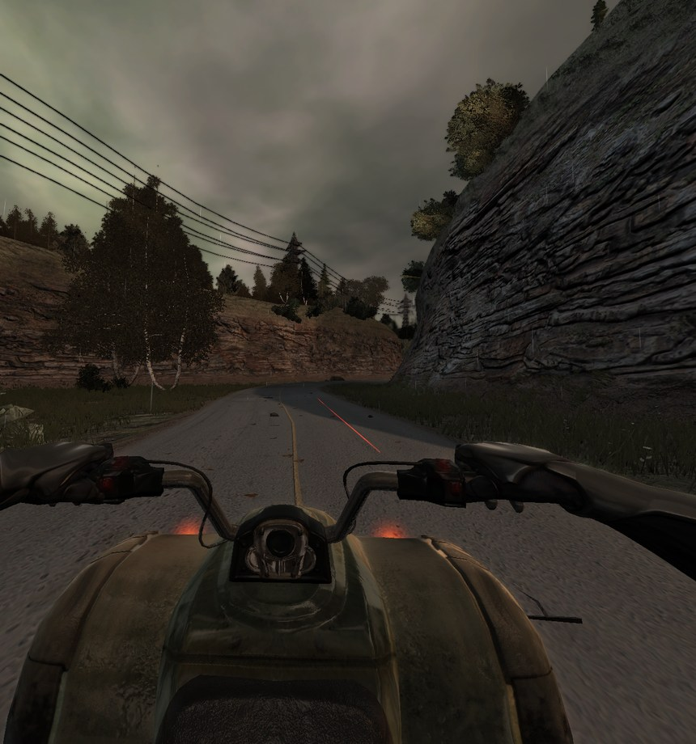

> [!IMPORTANT]
> **DOWNLOAD & DISCUSSION**
>
> **[Join the Flat2VR Discord](https://discord.gg/P4q9zt7ek)** · **[Open the TimeShift VR thread](https://discord.com/channels/747967102895390741/1564275115871707167)**
>
> Get the mod and share feedback in the game’s Flat2VR thread.

  

## Features

**Stereo head tracking · Roomscale and seated play · Tracked rifle and free hand · Fist and weapon strikes · Dynamic weather**

###  Punch enemies or strike with your weapon

Swing a bare hand for a close-range hit, or use the weapon you’re holding to strike. Release the foregrip to free your other hand for melee.

###  Freeze, slow or rewind the fight

Use the right stick to control time. Freeze a firefight to move to another angle, slow it to give yourself time to aim, or rewind to try the encounter again.

###  Duck into cover and brace your rifle

Crouch physically in Roomscale. Reach for the foregrip with your free hand to steady the rifle as you bring it back up.

###  Follow the barrel laser and feel the shot

The laser shows where the muzzle is pointing. Feel the trigger break as you squeeze and the recoil when a round fires.

###  Fight through a different sky on each run

Start the game at a different time of day with new weather. Watch wind push the rain sideways and see wet pavement gradually dry when the rain stops.

## Installation

1. Install the original **TimeShift** on PC.
2. **Put the mod archive next to `TimeShift.exe`** in the `bin` folder. Extract the entire archive one level up, into the main TimeShift folder. The `Put Me in Folder of Game` folder should sit beside `bin`.
3. Connect your PC VR headset, select your OpenXR runtime, and run **`RUN.bat`** from the extracted mod folder.

## In-game screenshots

  
  

*The same stretch of road in dry weather and in rain.*

[Tester credits](TESTERS.md)

## Other VR mods

| VR mod | Highlights |
| --- | --- |
| [Alone in the Dark (2008) VR](https://github.com/Monsterdeadwood/AloneInTheDark2008VR) | Sweep a flashlight across the room, then grab a chair and carry it by hand. |
| [Battlefield 3: VRevamp](https://github.com/Monsterdeadwood/Battlefield-3-VRevamp) | Pull a dropped enemy rifle toward you, take it with your other hand and fire. |
| [Burnout Paradise Remastered VR](https://github.com/Monsterdeadwood/BUrnOutPvr) | Look into a corner, drift through it and hit boost as you straighten out. |
| [Crysis 2: VRevamp](https://github.com/Monsterdeadwood/C2VR) | Lift an enemy with your free hand and fling them across the room with a swing. |
| [NOVA · CS:GO Legacy VR](https://github.com/Monsterdeadwood/CSGOVR) | Bring the AWP’s scope up to your eye and feel the kick when you shoot. |
| [Metro 2033 VR](https://github.com/Monsterdeadwood/Metro2033VR) | Ricochet a glowing power core down a tunnel and watch it light the walls as it travels. |
| [Rainbow Six Siege VR](https://github.com/Monsterdeadwood/SiegeVR) | Reach for the rifle’s foregrip and steer the muzzle with both hands. |
| [Star Wars: The Force Unleashed II VR](https://github.com/Monsterdeadwood/TFU2VR) | Hold a Stormtrooper in the air with the Force and swing a lightsaber with your other hand. |
| [Titanfall 1 VR](https://github.com/Monsterdeadwood/Titanfall1VR) | Call down a Titan, climb in and send captured shots back with the Vortex Shield. |
| [You Are Empty: Absolute Edition VR](https://github.com/Monsterdeadwood/YouAreEmptyAEVR) | Keep your gun trained ahead with your right hand and strike with your free left. |
