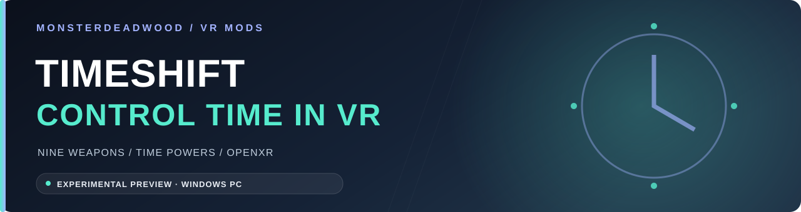

> [!IMPORTANT]
> **[ТЕСТИРОВАНИЕ И ОБСУЖДЕНИЕ · FLAT2VR DISCORD](https://discord.gg/P4q9zt7ek)**
> Тестирование, запрос сборок, отзывы и обсуждение проходят в **Flat2VR Modding Discord**. Перейди на сервер и найди тему **TimeShift VR**.

# TimeShift VR

[English](README.md) · [Русский](README_RU.md) · [Flat2VR Discord](https://discord.gg/P4q9zt7ek) · [All projects](PORTFOLIO.md)

TimeShift в VR: оружие от контроллеров, управление временем, поддержка второй рукой и меню VR-настроек. Можно играть сидя или включить Roomscale для приседания движением шлема через родную систему поз.

**Текущая описанная ветка: R65a community package / R66 precision candidate.**

## Установка

1. Возьми актуальную тестовую сборку **TimeShift VR** в теме TimeShift на Flat2VR и проверь совместимость игрового EXE.
2. Распакуй целую папку **Put Me in Folder of Game** в каталог TimeShift рядом с **bin**.
3. Подключи PC VR, включи OpenXR runtime и открой **RUN.bat** в папке мода.
4. По умолчанию выбран режим сидя. Удерживай Left Menu, открой Options → VR Settings, выбери Roomscale и коротко нажми Left Menu на удобной высоте.

Доступность актуальных тестовых пакетов уточняется в Discord. Нужен полный пакет для поддерживаемой версии игры; страница проекта сама по себе не является скачиваемым релизом.

## Что есть в проекте

- Стерео-VR, прицеливание от контроллера и все девять видов оружия в тестовой ветке.
- Замедление, остановка и обращение времени с контроллера.
- Поддержка оружия второй рукой в штатных точках хвата; после отпускания рука свободна.
- Сохраняемые VR-настройки, плавный/шаговый поворот, режимы сидя и Roomscale.
- Физическое приседание использует штатный профиль позы и коллизии игры.
- Индикация подготовки запуска и локальные диагностические SEND_TO_DISCORD-архивы.

<b>Краткое управление</b>

| Действие / кнопка | Назначение |
| --- | --- |
| Left stick / click | Движение / присесть при удержании |
| Right stick horizontal | Плавный или шаговый поворот |
| Right stick up / down / click | Обратить / замедлить / остановить время; повтор отменяет режим |
| Right trigger / left trigger | Основной / дополнительный огонь |
| Right grip / left grip | Перезарядка / поддержка у точки хвата, иначе Use + лазер |
| A / X | Прыжок и подтверждение / взаимодействие |
| B tap / hold | Следующее / предыдущее оружие |
| Y tap / hold | Бросить гранату / сменить её тип |
| Left Menu tap / hold | Сброс камеры / меню; порог удержания 650 мс |

Полная инструкция управления в конкретной сборке учитывает её версию и профиль контроллеров.

## Текущий статус

**Экспериментальная сборка.** Проверки настоящей игры/XR Sim охватывают позы, сброс камеры, выбранные видеопереходы и стрельбу девятью видами оружия в зафиксированных версиях.

- Комфорт в физическом шлеме и Roomscale во всей кампании ещё проверяются; низкие потолки, лестницы и платформы требуют более широких тестов.
- Совместимость привязана к поддерживаемым EXE сборки; работа со всеми Steam/retail-версиями не установлена.

R66 проверяет точность основного огня по контроллеру с сохранением конуса дроби. Это отдельный кандидат; precision_aim=false возвращает исходную модель точности.

[Подробный статус и область проверки](docs/PROJECT_STATUS.md)

## Тестирование и отзывы

Напиши в [тему игры на Flat2VR](https://discord.gg/P4q9zt7ek): укажи **версию мода, игру/магазин, шлем, OpenXR runtime, GPU, шаги воспроизведения и диагностический ZIP сборки**. Для проблем изображения или управления полезно короткое видео.

## Другие мои VR-моды

| Игра / проект | Направление | Доступ |
| --- | --- | --- |
| [Assassin’s Creed VR](https://github.com/Monsterdeadwood/AC1VR) | Обзор от первого лица, лазание и меч | Закрытый |
| [Crysis 2: VRevamp](https://github.com/Monsterdeadwood/C2VR) | Нанокостюм, физическое взаимодействие и интерфейс | Открытый |
| [NOVA · CS:GO Legacy VR](https://github.com/Monsterdeadwood/CSGOVR) | Локальные матчи CS:GO Legacy с VR-управлением | Открытый |
| [You Are Empty: Absolute Edition VR](https://github.com/Monsterdeadwood/YouAreEmptyAEVR) | Absolute Edition в VR, оружие и взаимодействие | Открытый |
| [Alone in the Dark 2008 VR](https://github.com/Monsterdeadwood/AloneInTheDark2008VR) | VR-хоррор и взаимодействие с предметами | Открытый |
| [Rainbow Six Siege VR](https://github.com/Monsterdeadwood/SiegeVR) | Стерео и оружие от контроллеров в старой Siege | Открытый |
| [Burnout Paradise Remastered VR](https://github.com/Monsterdeadwood/BUrnOutPvr) | Стереовождение, меню автомобилей и эффекты | Открытый |
| [Titanfall 1 VR](https://github.com/Monsterdeadwood/Titanfall1VR) | Бой пилота и кабины титанов | Открытый |
| [Metro 2033 VR](https://github.com/Monsterdeadwood/Metro2033VR) | Оригинальная Metro в VR и нативная физика | Открытый |
| [Insurgency VR](https://github.com/Monsterdeadwood/InsurgencyVR) | Начальная подготовка VR-интеграции | Закрытый |
| [Counter-Strike: Source VR](https://github.com/Monsterdeadwood/CSSVR) | Разработка VR для Counter-Strike: Source | Закрытый |

Ссылки на закрытые репозитории доступны приглашённым участникам. Открытые страницы отмечены в таблице.

## Авторство и заметки разработки

Проект ведёт [Monsterdeadwood](https://github.com/Monsterdeadwood). Это независимый фанатский VR-проект; нужна собственная поддерживаемая копия оригинальной игры.

[Прежний обзор репозитория, сохранённый как история](README_RESEARCH_ARCHIVE.md).

Описание сверено: **14 ноября 2026 года**.
